<div align="center">

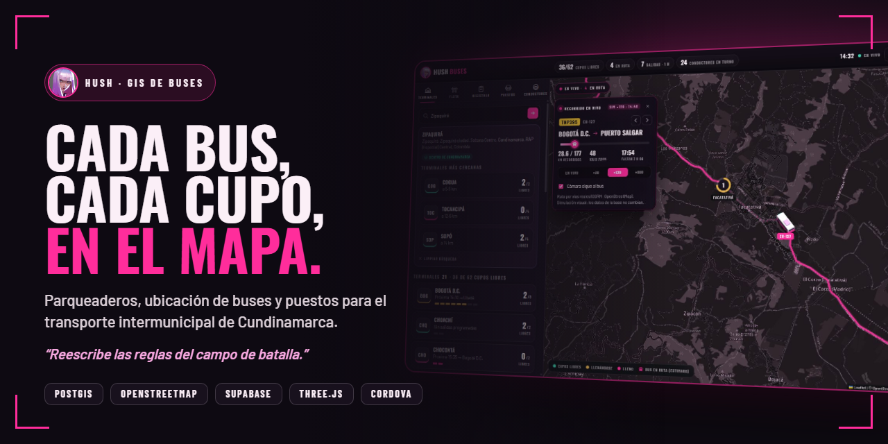

<br>

**Sistema de información geográfica para una empresa de transporte intermunicipal de Cundinamarca, Colombia.**<br>
Disponibilidad de parqueaderos, ubicación de buses y puestos por bus sobre un mapa dinámico de OpenStreetMap.

<br>

[](https://hushbusapp.vercel.app)
[](https://hushbusapp.vercel.app/app/index.html)
[](docs/Guia-Demostracion-Hush-Buses.pdf)


*“Reescribe las reglas del campo de batalla.”*

</div>

---

## ✦ El reto

Taller 2 — **Geocodificación y uso de mapas dinámicos**. Una empresa de transporte intermunicipal necesita un software que, **solo dentro de los límites de Cundinamarca**, responda tres preguntas:

| | Pregunta | Cómo la resuelve Hush |
|:-:|---|---|
| **a** | ¿Cuántos cupos libres hay en cada parqueadero? | Cada llegada abre una estadía y cada salida la cierra; `v_parking_availability` compara estadías abiertas con la capacidad, y un trigger con bloqueo de fila impide el sobrecupo. |
| **b** | ¿Dónde está cada bus? | En el parqueadero de su estadía abierta. En ruta, PostGIS estima la posición con `ST_LineInterpolatePoint` y el mapa lo anima sobre la vía real. |
| **c** | ¿Cuántos puestos le quedan a cada bus? | Cada tiquete es un puesto de un viaje: disponibles = capacidad − vendidos. La base rechaza puestos duplicados o inexistentes. |

Además se entregan: diseño con el **modelo de vistas 4+1**, la **base de datos PostGIS**, el **sistema web** con el mapa de OpenStreetMap y una **app móvil en Cordova**.

## ✦ Recorrido visual

<table>
  <tr>
    <td width="50%">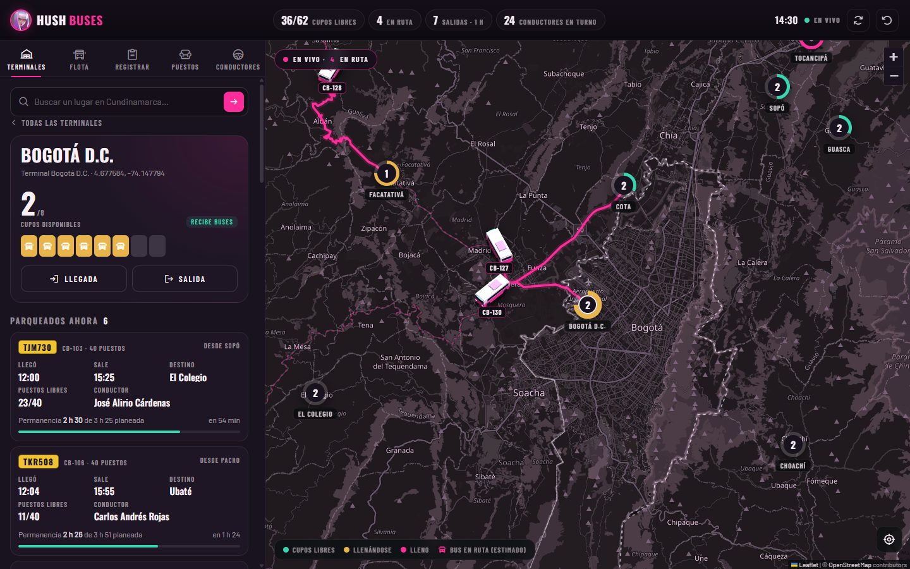<br><sub><b>Terminales</b> — cupos libres, buses parqueados, permanencia, próximas salidas y conductores.</sub></td>
    <td width="50%">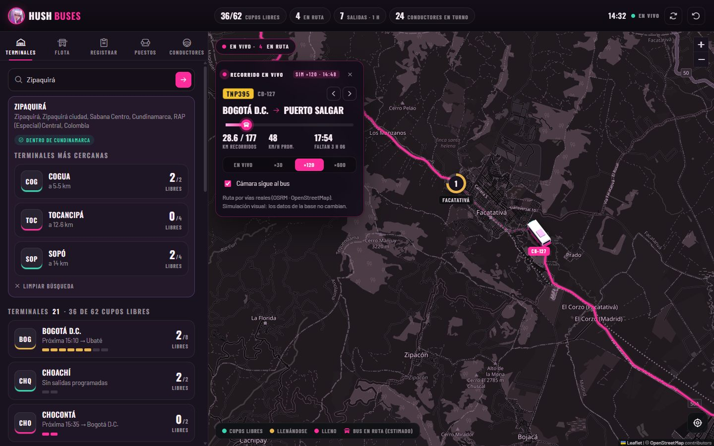<br><sub><b>En vivo</b> — bus 3D sobre la vía real (OSRM), cámara que lo sigue y reloj ×30–×600.</sub></td>
  </tr>
  <tr>
    <td>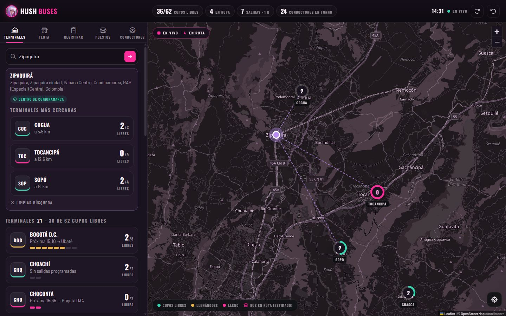<br><sub><b>Geocodificación</b> — Nominatim + KNN de PostGIS para la terminal más cercana.</sub></td>
    <td>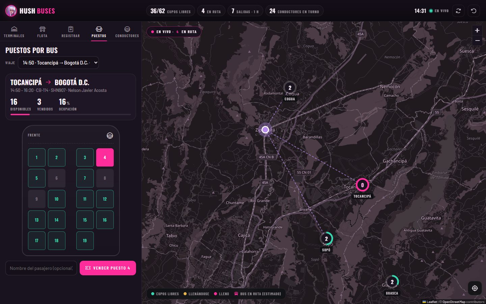<br><sub><b>Puestos</b> — mapa 2+2 del bus y venta de puestos con reglas en la base.</sub></td>
  </tr>
  <tr>
    <td>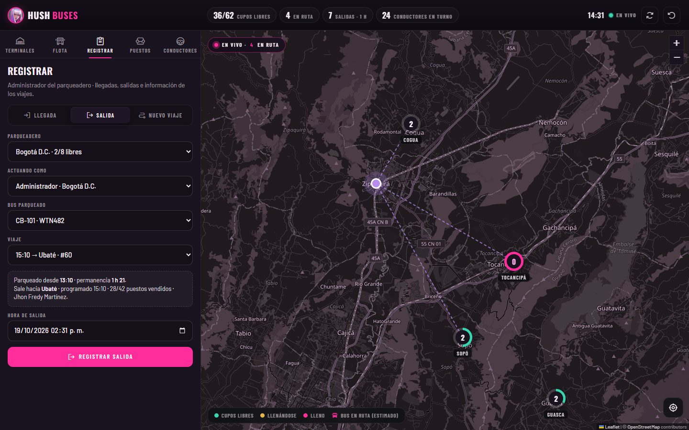<br><sub><b>Registrar</b> — llegadas, salidas y viajes (origen, destino, horas, permanencia).</sub></td>
    <td>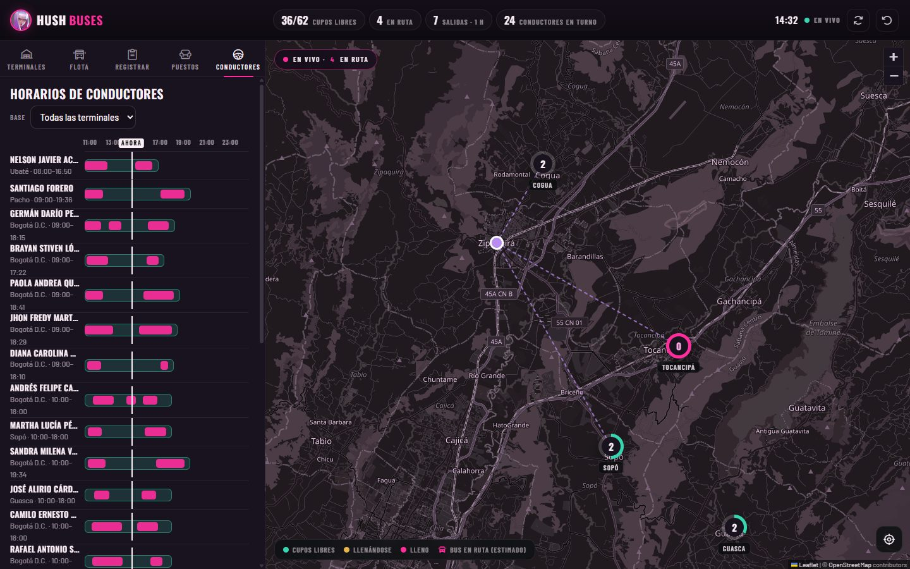<br><sub><b>Conductores</b> — horarios de servicio y viajes asignados con línea de “ahora”.</sub></td>
  </tr>
  <tr>
    <td>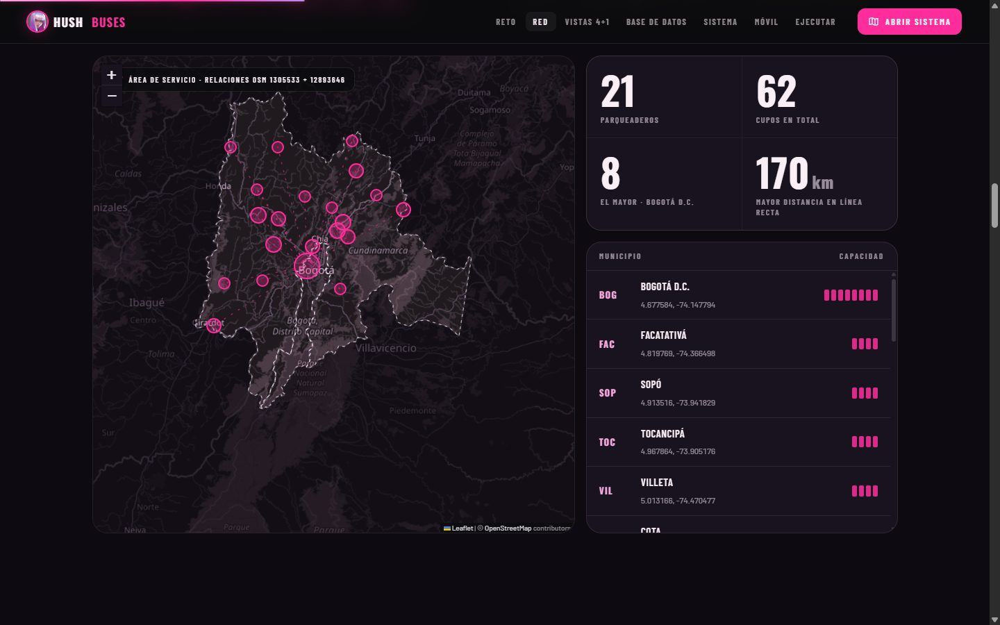<br><sub><b>La red</b> — los 21 parqueaderos del enunciado y la frontera del departamento.</sub></td>
    <td>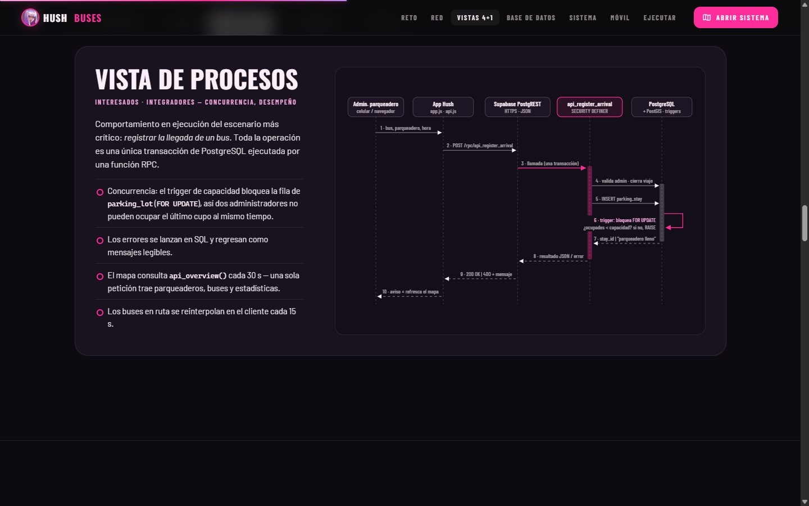<br><sub><b>Vistas 4+1</b> — escenarios, lógica, procesos, desarrollo y física.</sub></td>
  </tr>
</table>

<p align="center">
  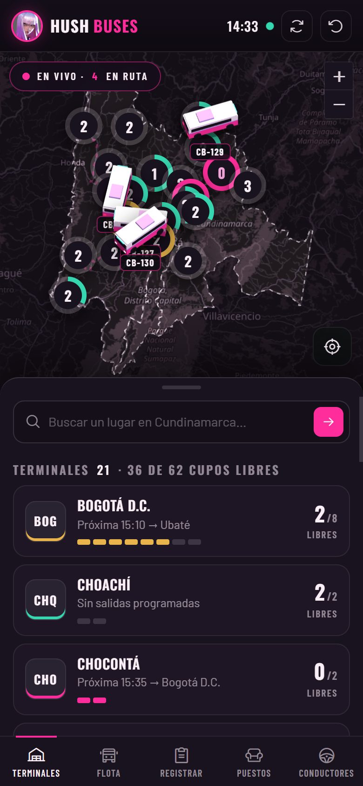
  &nbsp;&nbsp;
  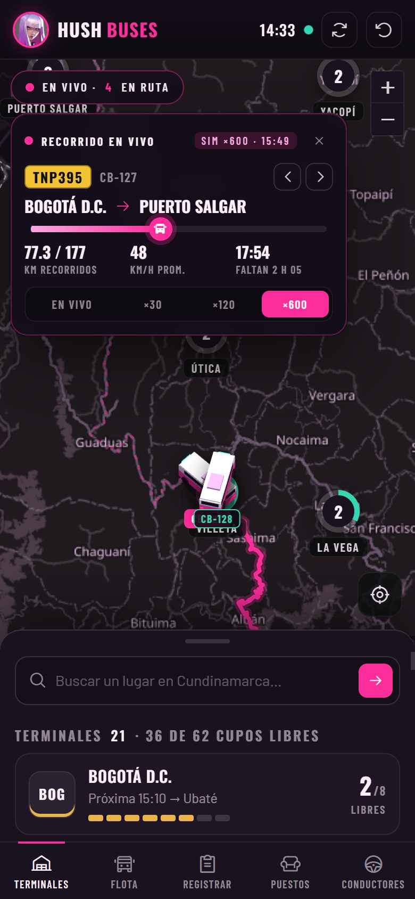
  <br><sub><b>App móvil (Cordova)</b> — el mismo código, con navegación inferior y GPS del dispositivo.</sub>
</p>

## ✦ Qué incluye

- **Página de inicio** con hero en video, animaciones ligadas al scroll, mapa de la red, diagramas 4+1 interactivos y el sistema embebido.
- **Sistema web** (Leaflet + OpenStreetMap): terminales, flota, registro de movimientos, puestos y horarios de conductores.
- **Recorrido en vivo**: bus 3D de bajo poligonaje (Three.js) que avanza por la vía real según la hora de salida y la de llegada.
- **Geocodificación** directa e inversa con Nominatim y terminal más cercana con el operador KNN `<->` de PostGIS.
- **Reglas de negocio dentro de PostgreSQL**: límites del departamento, capacidad, traslapes, puestos y permisos por parqueadero.
- **App móvil Cordova** que empaqueta exactamente el mismo código del sistema web.
- **Documentación**: [vistas 4+1](docs/ARCHITECTURE.md) y [guía de demostración en PDF](docs/Guia-Demostracion-Hush-Buses.pdf).

## ✦ Arquitectura

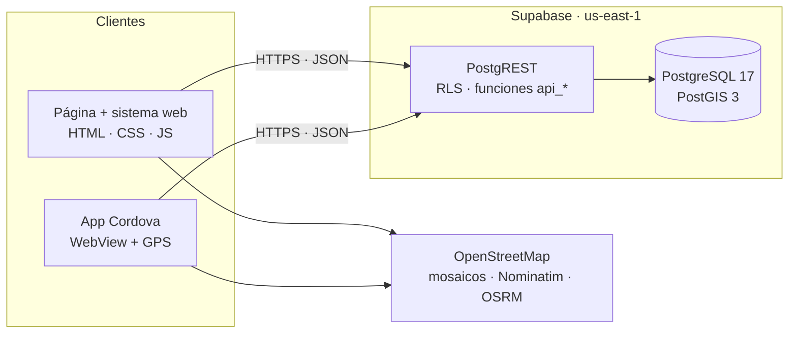

No hay servidor de aplicaciones propio: los clientes son estáticos (servidos en **Vercel**) y hablan directo con la API de Supabase. Toda escritura pasa por funciones `api_*` que ejecutan las reglas en una sola transacción. El detalle de las cinco vistas está en [`docs/ARCHITECTURE.md`](docs/ARCHITECTURE.md).

### Base de datos (SRID 4326)

| Tabla | Rol |
|---|---|
| `service_area` | Polígonos de Cundinamarca y Bogotá D.C. tomados de OpenStreetMap |
| `parking_lot` | Los 21 parqueaderos del taller · capacidad · `geometry(Point)` + GiST |
| `bus` | Flota · placa colombiana · capacidad de puestos |
| `trip` | Información del bus: origen, destino, salida, llegada, permanencia, estado |
| `parking_stay` | Llegada + salida registradas por el administrador → permanencia real y ubicación |
| `ticket` | Puesto vendido, único por viaje |
| `driver` · `driver_shift` | Conductores y turnos de servicio (≤ 12 h, sin traslapes) |
| `app_user` | Administradores de cada parqueadero |

Vistas: `v_parking_availability` · `v_bus_location` · `v_trip_detail` · `v_parked_buses` · `v_driver_schedule` · `v_stay_history`.

## ✦ Ejecutarlo

**1. Base de datos.** Cree un proyecto en [Supabase](https://supabase.com) y, en el SQL Editor, ejecute en orden:

```text
database/01_schema.sql       tablas, restricciones e índices espaciales
database/02_functions.sql    reglas: límites, capacidad, traslapes, puestos, llegada/salida
database/03_views.sql        vistas de disponibilidad, ubicación, puestos y horarios
database/04_service_area.sql polígonos de Cundinamarca y Bogotá D.C.
database/05_seed.sql         21 parqueaderos + flota, conductores y operación demo
database/06_api.sql          RLS y funciones RPC públicas
database/07_hardening.sql    ajustes de seguridad y validaciones
```

**2. Conectar.** En [`app/js/config.js`](app/js/config.js) ponga la URL del proyecto y la llave pública (*publishable key*). Es segura de publicar: RLS solo permite lecturas y las escrituras pasan por las funciones `api_*`.

**3. Servir.**

```bash
npx serve .
```

Abra `http://localhost:3000` (página) o `http://localhost:3000/app/` (sistema).

**4. App móvil** (requiere Android SDK y JDK 17):

```bash
cd mobile
npm install
npm run sync
npx cordova platform add android
npx cordova run android
```

> El sitio necesita internet: carga mosaicos de OpenStreetMap, Nominatim, OSRM y librerías desde CDN (Leaflet, supabase-js, Three.js, Phosphor, Google Fonts).

## ✦ Estructura

```text
.
├── index.html              página de inicio (landing)
├── app/                    sistema web — también es la app móvil
│   ├── index.html
│   ├── css/app.css
│   └── js/                 config · api (datos) · app (UI) · live (en vivo) · bus3d (Three.js)
├── database/               SQL 01–07 + consultas de ejemplo
├── mobile/                 proyecto Cordova (config.xml, sync de www/)
├── assets/                 video del hero, ícono y datos de la red
├── docs/                   vistas 4+1, guía PDF, capturas y banner
└── vercel.json             despliegue estático
```

## ✦ Seguridad

- **RLS** en las 9 tablas: los clientes solo leen; no existen políticas de escritura.
- Escrituras únicamente por funciones `api_*` (*SECURITY DEFINER*) que validan cada regla.
- Documento y teléfono de los conductores no son públicos (permisos por columna).
- Todo texto externo se escapa antes de mostrarse.
- Proyecto académico sin inicio de sesión: cualquiera con la página puede registrar movimientos de demostración (el botón ↺ regenera los datos). En producción se añadiría Supabase Auth.

## ✦ Equipo

| Desarrolladores |
|---|
| **Andres Camilo Aldana Cantor** |
| **David Alejandro Castro Peña** |
| **Alejandro Agudelo Quintero** |

Taller 2 — Geocodificación y uso de mapas dinámicos · Profesor **Carlos Armando López Solano, MSc.**

## ✦ Créditos y licencia

- Código bajo licencia [MIT](LICENSE).
- Datos del mapa © colaboradores de [OpenStreetMap](https://www.openstreetmap.org/copyright) (ODbL) · rutas [OSRM](https://project-osrm.org) · geocodificación [Nominatim](https://nominatim.org).
- Video del hero: “Buses and cars in the freeway”, [Mixkit](https://mixkit.co) (licencia Mixkit).
- Íconos: [Phosphor Icons](https://phosphoricons.com) (MIT).
- La temática, el nombre, el eslogan y el ícono de **Hush** pertenecen a **Riot Games** (VALORANT). Este es un proyecto académico de fans, sin afiliación ni respaldo de Riot Games; esos recursos no están cubiertos por la licencia MIT.
