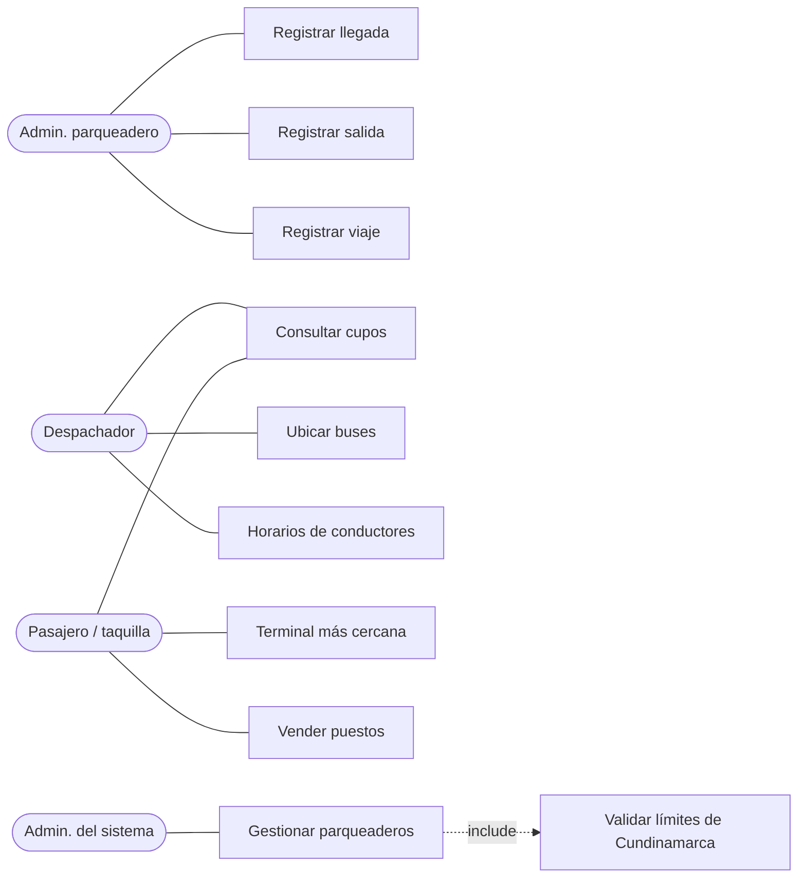
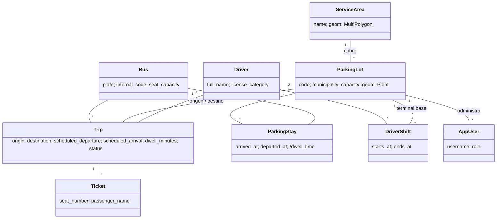
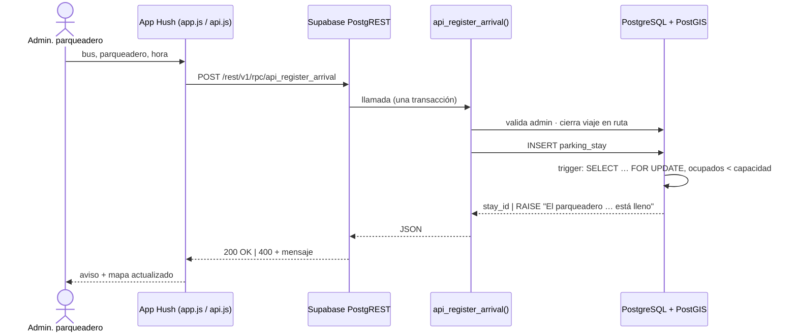
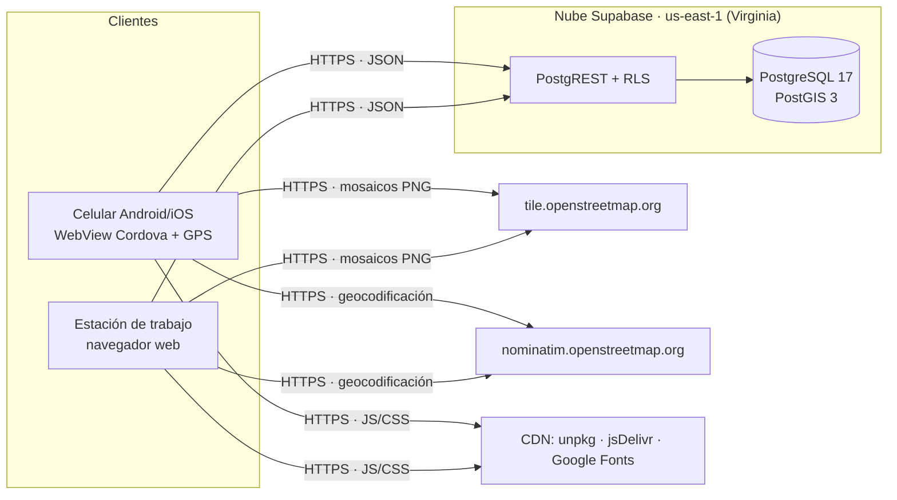

# Arquitectura — Modelo de vistas 4+1

Sistema **Hush** · Taller 2: Geocodificación y uso de mapas dinámicos.

El modelo 4+1 (Kruchten, 1995) describe el sistema desde cinco puntos de vista. Las cuatro vistas
—lógica, de procesos, de desarrollo y física— se validan con la quinta: los escenarios.

---

## +1 · Vista de escenarios (casos de uso)

**Interesados:** todos. **Propósito:** validar y relacionar las demás vistas.

| Actor | Casos de uso |
|---|---|
| Administrador del parqueadero | CU1 Registrar llegada del bus · CU2 Registrar salida del bus · CU3 Registrar datos del viaje (origen, destino, hora de salida, hora de llegada, permanencia) |
| Despachador | CU4 Consultar cupos disponibles · CU5 Ubicar buses en el mapa · CU6 Consultar horarios de conductores |
| Pasajero / taquilla | CU4 Consultar cupos disponibles · CU7 Buscar terminal más cercana (geocodificación) · CU8 Consultar y vender puestos |
| Administrador del sistema | CU9 Gestionar parqueaderos «include» CU10 Validar límites de Cundinamarca |

**Escenario principal — CU1 Registrar llegada**
1. El administrador selecciona su parqueadero, el bus y la hora de llegada.
2. El sistema verifica que el usuario administre ese parqueadero.
3. Si el bus venía en un viaje hacia ese parqueadero, el viaje se cierra (`ARRIVED`).
4. Se abre una estadía (`parking_stay`) — el bus queda ubicado en el parqueadero.
5. Si el parqueadero está lleno, la operación se rechaza y se informa al usuario.

---

## 1 · Vista lógica

**Interesados:** usuarios finales y analistas. **Propósito:** funcionalidad (modelo del dominio).

- **Trip** es la “información del bus” exigida: origen, destino, hora de salida, hora de llegada y
  tiempo de permanencia en el parqueadero de destino.
- **ParkingStay** es lo que registra el administrador: una llegada y luego una salida. Su intervalo
  es la permanencia real y su existencia (abierta) define la ubicación del bus.
- **Ticket** representa un puesto vendido; puestos disponibles = capacidad − tiquetes.

---

## 2 · Vista de procesos

**Interesados:** integradores. **Propósito:** concurrencia, desempeño, comportamiento en ejecución.

- **Atomicidad:** cada registro es una sola transacción dentro de una función PL/pgSQL.
- **Concurrencia:** el trigger de capacidad bloquea la fila del parqueadero (`FOR UPDATE`); dos
  administradores no pueden ocupar el último cupo al mismo tiempo.
- **Actualización:** el mapa consulta `api_overview()` cada 30 s (una sola petición trae
  parqueaderos, buses y estadísticas). Los buses en ruta se reinterpolan en el cliente cada 15 s.
- **Ubicación sin GPS:** el taller no exige rastreo en tiempo real; en ruta la posición se estima con
  `ST_LineInterpolatePoint` según el tiempo transcurrido.

---

## 3 · Vista de desarrollo

**Interesados:** programadores. **Propósito:** organización del código y del software.

| Capa | Componentes | Archivos |
|---|---|---|
| Presentación | Página de inicio · Sistema web · App Cordova | `index.html`, `app/index.html`, `app/css/app.css`, `mobile/` |
| Lógica cliente | Estado, paneles y formularios · Mapa Leaflet + OSM · Acceso a datos | `app/js/app.js`, `app/js/api.js`, `app/js/config.js` |
| API | PostgREST (REST/RPC) · Políticas RLS · funciones `api_*` | `database/06_api.sql` |
| Reglas de negocio | `fn_register_arrival/departure` · triggers | `database/02_functions.sql` |
| Datos | Tablas · vistas · PostGIS · datos semilla | `database/01, 03, 04, 05_*.sql` |

Decisiones:
- Las reglas viven **en la base de datos**: la web, la app móvil y cualquier cliente futuro obedecen
  las mismas reglas sin duplicar código.
- `app/` se comparte tal cual con Cordova (`npm run sync`).
- `api.js` es el único módulo que se comunica con la red (Supabase y Nominatim).

---

## 4 · Vista física

**Interesados:** ingenieros de sistemas. **Propósito:** despliegue, topología y comunicaciones.

- No hay servidor de aplicaciones propio: el único servidor es el proyecto administrado de Supabase.
- Los clientes son estáticos (HTML/CSS/JS) y se pueden servir desde cualquier hosting o empaquetar
  con Cordova.

---

## Diseño de la base de datos

Nueve tablas con geometrías en SRID 4326 (WGS 84):

| Tabla | Rol | Claves / restricciones |
|---|---|---|
| `service_area` | Límites de Cundinamarca y Bogotá D.C. | `geom MultiPolygon`, índice GiST |
| `parking_lot` | Los 21 parqueaderos del taller | `geom Point`, `capacity 1..50`, trigger de límites |
| `app_user` | Administradores | rol `LOT_ADMIN` exige `parking_lot_id` |
| `driver` / `driver_shift` | Conductores y horarios de servicio | turnos ≤ 12 h sin traslape |
| `bus` | Flota | placa `^[A-Z]{3}[0-9]{3}$`, `seat_capacity 10..60` |
| `trip` | Información del bus | origen ≠ destino, llegada > salida, sin traslapes |
| `ticket` | Puestos vendidos | único `(trip_id, seat_number)` |
| `parking_stay` | Llegadas y salidas | una estadía abierta por bus, trigger de capacidad |

Vistas: `v_parking_availability`, `v_bus_location`, `v_trip_detail`, `v_parked_buses`,
`v_driver_schedule`, `v_stay_history`.
